<h1 align="center">🌿 VERDA</h1>

<p align="center"><b>See which bed needs you, and what to do before a cold night, from your phone.</b></p>

---

**VERDA** helps home gardeners manage an unheated greenhouse remotely. A live **zone map** shows which bed is too hot, too dry or at risk of frost. A **dashboard** shows the overall picture. A **cold-night card** lists what still needs doing before the gardener leaves. Watering, vents and grow lights can be switched from anywhere.

Built by **Team Supernova** for the *Smart Greenhouse* course project (6 weeks, November–December 2026).

## Target user

Aigerim, 37, grows tomato seedlings, cucumbers and lettuce in an unheated 6-bed greenhouse at her dacha. She works weekdays in the city, can't ventilate at midday, waters by guesswork, and sometimes forgets to close the vents or cover the seedlings before a frosty night. Full persona: [project charter](docs/week1-project-charter.md).

## Team and roles

| Member | Role | Owns in the app (code + design) |
|---|---|---|
| **Aiken Amanbay** | Lead mobile developer | Project setup, navigation, M1 Login, M2 Dashboard, Zone Map, M3 Device control |
| **Arujan Tulegenova** | Product designer | Logo, design system, Figma mockups and clickable prototype; codes the shared UI kit and the M7 Settings screen |
| **Assylai Zhumakulova** | Backend and data engineer | Firebase project, Firestore schema, security rules, test-data seed, data layer, M4 Automation, M8 Offline, cold-night logic |
| **Assel Balgabay** | Product manager and QA | Charter, README, task board, M5 Alerts, M6 History charts, testing, demo video, final presentation |

Every member commits code every week; the brief asks for 20+ meaningful commits each.

## Project status

| Week | Deliverable | Status |
|---|---|---|
| 1 | Idea and team: [project charter](docs/week1-project-charter.md) ([PDF](docs/VERDA-Week1-Project-Charter.pdf)) | ✅ |
| 2 | Design: [style, data structure, app diagram, stack](docs/week2-design.md) ([PDF](docs/VERDA-Week2-Design.pdf)) · Figma prototype | 🟡 Figma in progress ([link](https://www.figma.com/design/3alIxkFbGmd98m6Q3XBWZw/Verda?node-id=0-1)) |
| 3 | App skeleton and data | ⏳ |
| 4 | Login, dashboard, control (M1–M3) | ⏳ |
| 5 | Automation, alerts, history (M4–M8) | ⏳ |
| 6 | Extra feature and final defense | ⏳ |

**Figma:** [https://www.figma.com/design/3alIxkFbGmd98m6Q3XBWZw/Verda?node-id=0-1](https://www.figma.com/design/3alIxkFbGmd98m6Q3XBWZw/Verda?node-id=0-1)

## Screens

All 17 screens from the Figma file (files in [design/screens](design/screens)).

<table>
<tr><td align="center">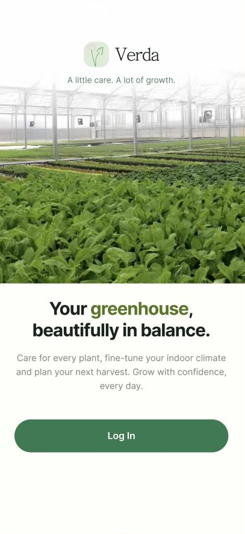<br>Beginning</td><td align="center">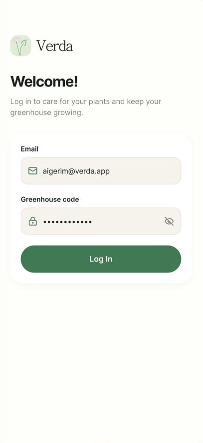<br>Login</td><td align="center">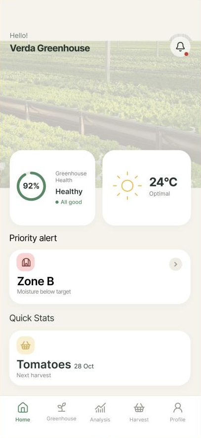<br>Home</td><td align="center">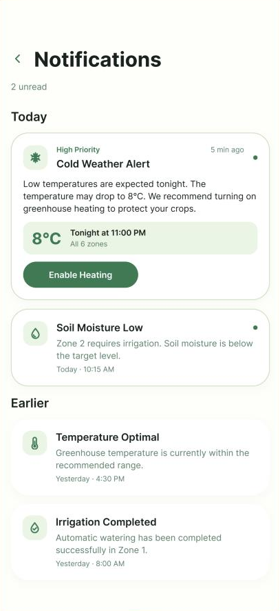<br>Notifications</td></tr>
<tr><td align="center">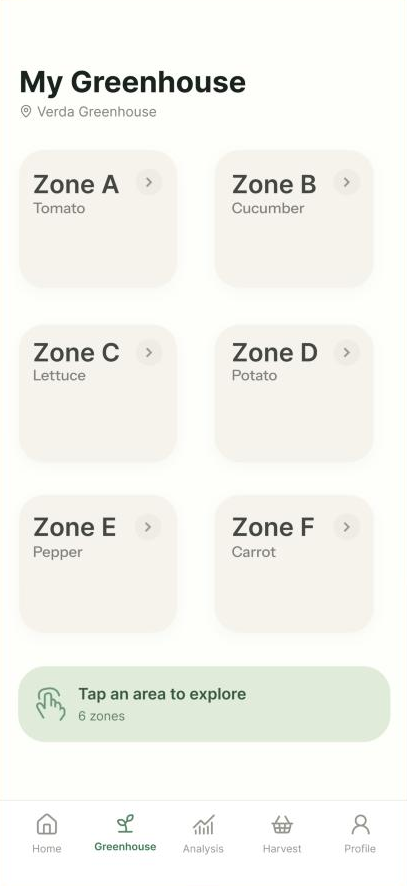<br>Greenhouse</td><td align="center"><br>Zone A</td><td align="center">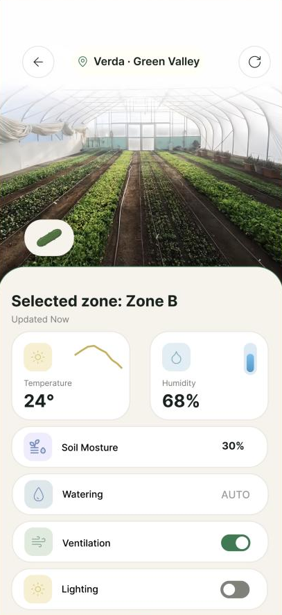<br>Zone B</td><td align="center">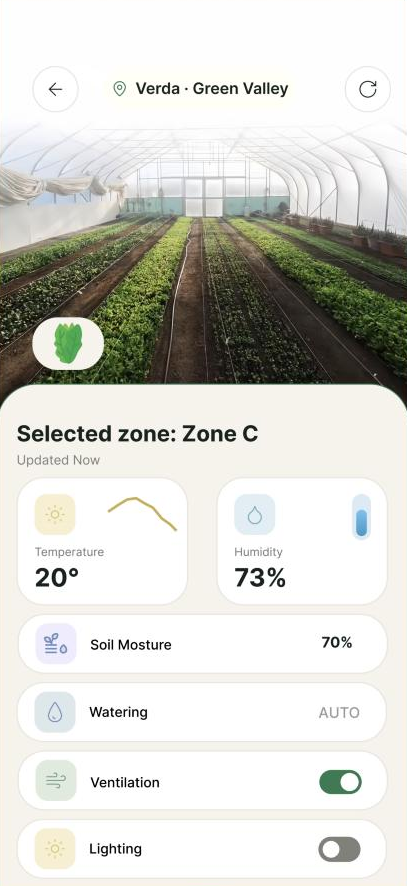<br>Zone C</td></tr>
<tr><td align="center">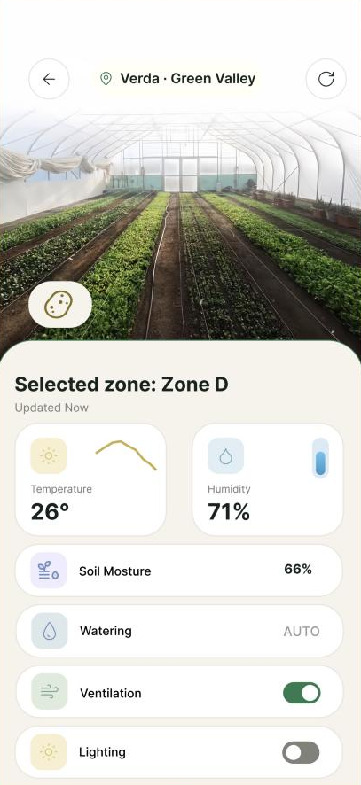<br>Zone D</td><td align="center">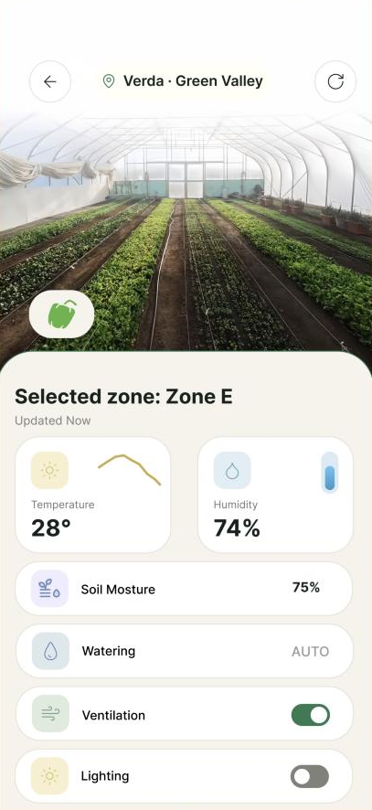<br>Zone E</td><td align="center"><br>Zone F</td><td align="center">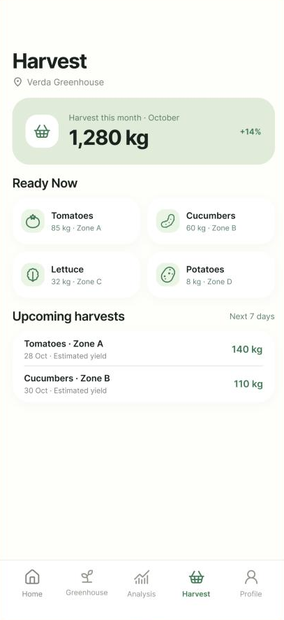<br>Harvest</td></tr>
<tr><td align="center">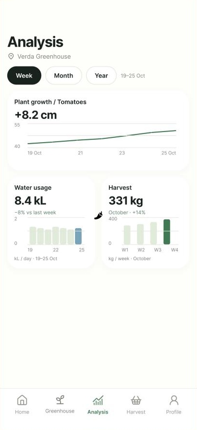<br>Analysis week</td><td align="center">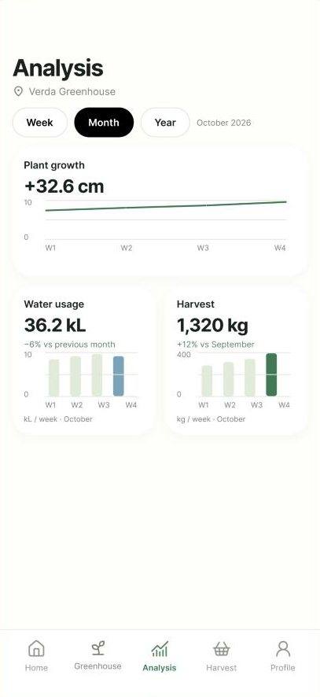<br>Analysis month</td><td align="center">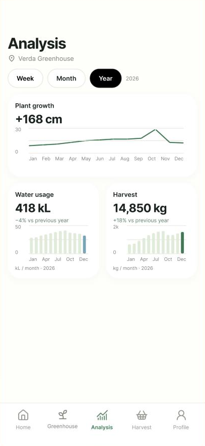<br>Analysis year</td><td align="center">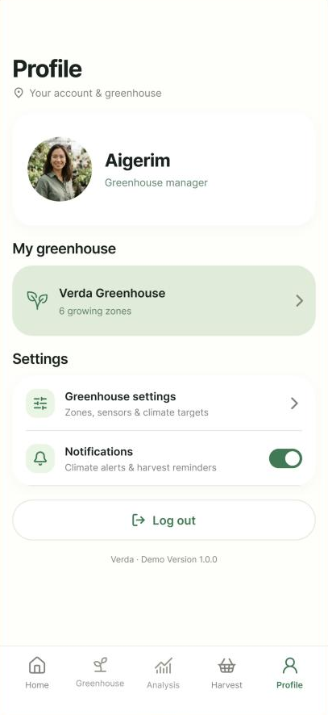<br>Profile</td></tr>
<tr><td align="center">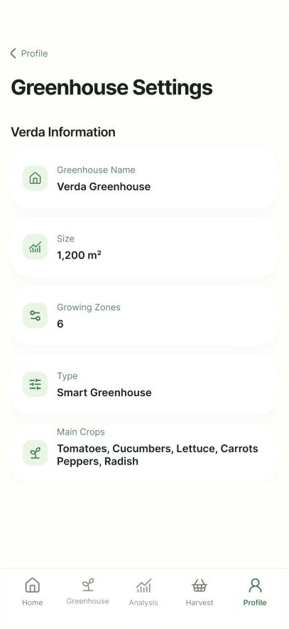<br>Settings</td></tr>
</table>

## Tech stack

**React Native (Expo, TypeScript) + Firebase (Auth, Cloud Firestore).** We all use iPhones, so we run the app through Expo Go and build the Android APK in the cloud with EAS. Reasons: [docs/week2-design.md](docs/week2-design.md#4-stack).

## How to run (from week 3)

```bash
git clone https://github.com/aikenamanbay/VERDA.git && cd VERDA/app
npm install
cp .env.example .env      # add the Firebase web config; never commit .env
npx expo start            # scan the QR code with Expo Go on iPhone
```

Android APK: `npx eas build -p android --profile preview`.

## Repository layout

```
VERDA/
├── README.md
├── design/   app diagram, screenshots of the Figma screens
├── docs/     week 1 charter, week 2 design (MD + PDF)
├── brief/    our idea deck (Supernova)
└── app/      Expo app (from week 3)
```
