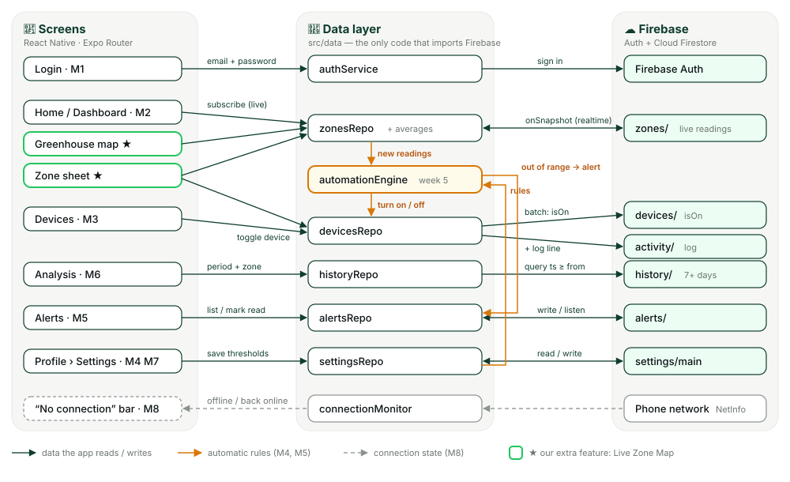
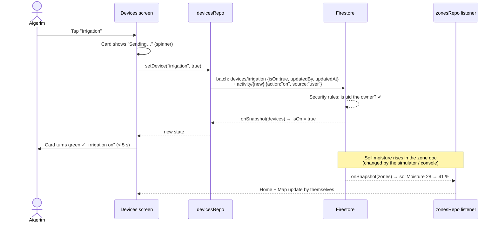

# Verda — App Diagram and Stack

## App diagram: screens → data layer → database

**Reading direction:** screens never call Firebase directly; they only call the data layer. The data layer is the only code that imports `firebase/*`. This is required in week 3 (rubric 3.4).

## Scenario: what happens when the user presses "Water"

Step by step:

1. **Tap** — the user taps the Irrigation card. The card shows "Sending…" right away.
2. **Data layer** — `devicesRepo.setDevice()` builds one batch write.
3. **Write** — Firestore gets `isOn: true`, `updatedBy: uid` and `updatedAt`, plus a new line in the `activity` log.
4. **Check** — the security rules allow the write only if this user owns the greenhouse.
5. **Confirm** — the realtime listener receives the new state, and the card turns green with ✓. If no answer arrives within 5 s: "Couldn't reach greenhouse. Try again."
6. **Result** — soil moisture in that zone rises; Home and Map update by themselves.
7. **Offline** — the toggle is disabled with the hint "No connection". We never pretend that a command was sent.

## Stack

| Layer | Choice | Why |
|---|---|---|
| Mobile app | **React Native + Expo (TypeScript)** | All four of us have iPhones: with **Expo Go** we run the app on our own phones by scanning a QR code, without Xcode signing. The same code builds the **Android APK** the course requires (`eas build`, in the cloud, no Android Studio). TypeScript catches data-shape mistakes early. |
| Navigation | Expo Router (tabs + stack) | File-based routes keep the 8+ screens organised and match the Figma flow one-to-one. |
| Auth + database | **Firebase Auth + Cloud Firestore** | Free tier. **Realtime `onSnapshot` listeners** make M2 "values update by themselves" almost free. Built-in **offline cache** helps M8. Security rules give "each user sees only their greenhouse" (M1) without writing our own server. The Firebase console lets the instructor edit values live during the defense. |
| Charts | react-native-gifted-charts | Simple line charts with axes and units for M6; works in Expo Go. |
| Alerts | expo-notifications | Local push notifications for M5, plus an in-app banner. |
| Offline | @react-native-community/netinfo | Detects lost or restored internet for the M8 banner. |
| Design | Figma + Inter + Lucide icons | Shared files for the whole team, clickable prototype, free fonts and icons. |

**Why not Flutter?** It would also work, but running it on an iPhone needs Xcode and an Apple ID signature that expires every 7 days. Expo Go removes that friction for an all-iPhone team.
**Why not Supabase?** Postgres is great, but Firestore's realtime listeners and offline cache cover M2 and M8 with less code, and the console is simpler to edit live during the defense.
