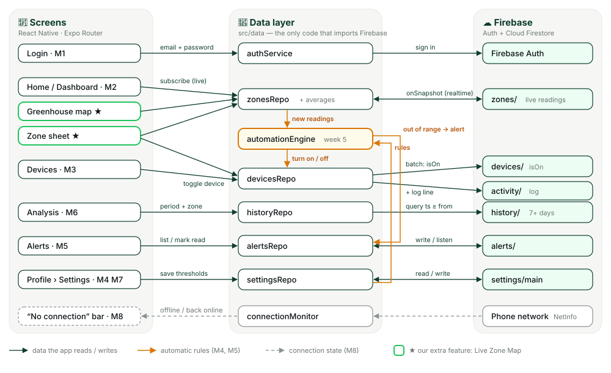

# VERDA — Week 2: Design

**Team Supernova** · Figma prototype: _add link_

## 1. Style: logo, colours, font

**Logo:** a sage tile with a pair of sprouting leaves, next to the wordmark **VERDA**. The tile is the greenhouse seen from above (the same rounded shape as the zone map); the leaves stand for growth. Tagline: "A little care. A lot of growth."

**Colours (5):**

| Colour | Hex | Used for | Why it suits Aigerim |
|---|---|---|---|
| Forest | `#26352C` | Headings, main text, dark buttons | Deep plant green, readable in sunlight |
| Sage | `#4B8864` | Main buttons, "Healthy" status, active tab | Calm natural green that reads as "all good" |
| Cream | `#F7F3EC` | App background | Warm and soft, like soil and paper, and easy on the eyes |
| Paper | `#FEFFFA` | Cards | Cards stand out on cream without heavy shadows |
| Muted | `#63756B` | Secondary text, inactive icons | A grey that stays on brand |

Red `#802E2F`, amber `#E3A33B` and blue `#6E9BC4` appear **only as status signals**: problem, warning, water or cold. Because they are used so rarely, an alert is never missed.

**Font:** **Inter**. It is free, has clear numbers that don't jump as readings change, and supports Cyrillic for a Russian or Kazakh version.

## 2. Data structure (Cloud Firestore)

Everything for one greenhouse lives under `greenhouses/{id}`, so one security rule (`ownerId == user`) keeps each user's data private (M1).

| Collection | What it stores | Main fields |
|---|---|---|
| `users/{uid}` | Account | `name`, `email`, `greenhouseId` |
| `greenhouses/{id}` | Greenhouse | `name`, `ownerId`, `mode` (`auto` / `manual`), `lastUpdate` |
| `…/zones/{zoneId}` | **Current readings** per bed | `name` ("Zone D"), `crop`, `plantCount`, `airTemp`, `airHumidity`, `soilMoisture`, `light`, `updatedAt` |
| `…/devices/{deviceId}` | **Devices** | `type` (irrigation / ventilation / growLights / frostHeater), `isOn`, `updatedAt`, `updatedBy` |
| `…/settings/main` | **Settings** | `cropProfiles` (min/max per crop), `rules` ("soilMoisture < 30 → irrigation 2 min"), `schedule`, `units` |
| `…/history/{id}` | **History**, one record per bed per hour, 7+ days | `ts`, `zoneId`, `airTemp`, `airHumidity`, `soilMoisture`, `light` |
| `…/alerts/{id}` | Alerts (M5) | `ts`, `zoneId`, `param`, `value`, `limit`, `read` |
| `…/forecast/tonight` | Extra feature | `outdoorLow`, `lowAt` |
| `…/checklist/tonight` | Extra feature | `seedlingsCovered`, `coveredAt` ("vents closed" is read live from `devices`) |

The dashboard averages are calculated in the app from all zones. The map colours each zone against its own crop's limits.

**What is written when a device is turned on:** `devices/irrigation` ← `{ isOn: true, updatedBy: uid, updatedAt: now }`.

## 3. App diagram: screens → data layer → database

Screens never talk to Firebase directly; only the data layer (`src/data`) does.

**What happens when the user presses "Water":**

1. Aigerim taps **Watering**, and the toggle shows "Sending…".
2. The screen calls `devicesRepo.setDevice("irrigation", true)`.
3. The data layer writes `isOn: true` to `devices/irrigation` in Firestore.
4. Firestore security rules check that this user owns the greenhouse.
5. The realtime listener receives the new state, and the toggle turns green "On ✓" (within 5 s).
6. Soil moisture in the zone rises, and Home and the map update by themselves.
7. If there is no internet, the toggle is disabled and the app says "No connection".

## 4. Stack

| Part | Choice | Why |
|---|---|---|
| Mobile app | **React Native + Expo** (TypeScript) | All four of us have iPhones: Expo Go runs the app on our phones from a QR code, without Xcode. The same code builds the Android APK the course requires. |
| Login + database | **Firebase Auth + Cloud Firestore** | Free. Realtime listeners update the dashboard by themselves (M2), there is a built-in offline cache (M8), and security rules show each user only their own greenhouse (M1). The instructor can change values live in the Firebase console. |
| Charts, alerts, network | react-native-gifted-charts, expo-notifications, NetInfo | Ready-made libraries for M6 charts, M5 notifications and the M8 "no connection" message. |
